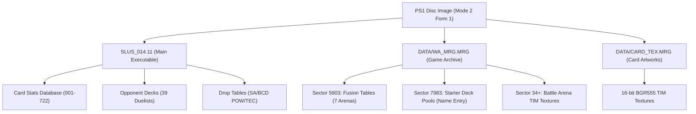

# Technical Architecture & Reverse Engineering Specification 🛠️📐

This document provides a comprehensive technical overview of the reverse engineering, memory structures, disc layout, and mathematical models utilized in the **Yu-Gi-Oh! Forbidden Memories ROM Suite**.

---

## 1. PlayStation 1 CD-ROM Format: Mode 2 Form 1

Yu-Gi-Oh! Forbidden Memories uses **CD-ROM XA Mode 2 Form 1** sectors for all game files and streaming archives. Every physical sector on the disc occupies exactly **2,352 bytes**, structured as follows:

```
+-----------------------------------------------------------------------------------------------+
|  Sync   | Header | Sub-header |      User Data Payload       |  EDC   | Zero Pad | P/Q Parity |
| 12 B    |  4 B   |    8 B     |          2,048 B             |  4 B   |   8 B    |   276 B    |
+-----------------------------------------------------------------------------------------------+
0         12       16           24                             2072     2076       2084         2352
```

### Sector Breakdown
1. **Sync Pattern (12 bytes):** `00 FF FF FF FF FF FF FF FF FF FF 00`
2. **Header (4 bytes):**
   - Minute (BCD, byte 12)
   - Second (BCD, byte 13)
   - Sector / Frame (BCD, byte 14)
   - Mode (byte 15, `0x02` for Mode 2)
3. **Sub-Header (8 bytes):** File number, Channel, Submode, and Coding Information (repeated twice for error resilience). For standard data sectors, Submode is `0x08` (Form 1, Data).
4. **User Data Payload (2,048 bytes):** The raw file contents accessible through ISO-9660 directory records.
5. **EDC - Error Detection Code (4 bytes, little-endian):**
   - 32-bit polynomial CRC calculated over bytes 16 through 2071 (Sub-header + User Data).
   - Generates the standard polynomial: $P(x) = (x^{16} + x^{15} + x^2 + 1)(x^{16} + x^2 + x + 1)$.
6. **Zero Pad (8 bytes):** Reserved zero padding (`0x00` bytes).
7. **L-EC Parity (276 bytes):**
   - **P-Parity (172 bytes):** Reed-Solomon $(26, 24)$ cross-interleaved parity computed over $GF(2^8)$ with primitive polynomial $P(x) = x^8 + x^4 + x^3 + x^2 + 1$ (`0x11D`).
   - **Q-Parity (104 bytes):** Reed-Solomon $(45, 43)$ cross-interleaved parity computed over $GF(2^8)$.

> **Note:** Whenever `core/builder.py` inyects modified files, it recalculates the EDC and regenerates all P/Q parity matrices on the fly using [`core/cdrom.py`](../core/cdrom.py). This prevents emulators or real hardware from rejecting the disc due to CRC or parity mismatches.

---

## 2. Disc Archive & Filesystem Structure

The game image contains several critical files responsible for runtime execution and asset storage:



### Key File Offsets & Physical Sector Map

| File / Region | Disc Sector / Offset | RAM Mapping | Description |
|---|---|---|---|
| `SLUS_014.11` | Sector 23+ | `0x80010000` | PS-X EXE containing code, card stats, drops, and duelist decks. |
| `DATA/WA_MRG.MRG` | Sector 5000+ | Dynamically Loaded | Main archive for battle overlays, 3D arenas, and fusion tables. |
| ↳ Arena 0 Fusion Table | Sector 5903 (`0x0B87800`) | `0x8017C2D8` (64 KB) | 722 pointer headers + variable-length fusion recipes. |
| ↳ Arena 0 TIM Graphics | Sector 5936 (`0x0B98000`) | VRAM / Textures | Texture page for Arena 0. Stored immediately following the fusion table. |
| ↳ Starter Deck Overlay | Sector 7983 (`0x00F97800`) | `0x8016a930` | Name Entry screen logic & 7 authentic card generation pools. |
| `DATA/CARD_TEX.MRG` | Variable | VRAM / Overlay | 722 individual 16-bit BGR555 TIM textures for card illustrations. |

---

## 3. Card Serialization & Description Engine

### 3.1 Card Attribute Struct Layout (`core/cards.py`)
Each of the 722 cards in `SLUS_014.11` is defined by a packed binary record consisting of:
- **Card ID:** 16-bit integer (1 to 722).
- **Attack (ATK):** 16-bit unsigned integer (0 to 9999).
- **Defense (DEF):** 16-bit unsigned integer (0 to 9999).
- **Guardian Stars:** 8-bit packed field representing Guardian Star 1 and Guardian Star 2 according to the celestial alignment wheel:
  $$\text{Wheel 1: } \text{Sun} \rightarrow \text{Moon} \rightarrow \text{Venus} \rightarrow \text{Mercury} \rightarrow \text{Sun}$$
  $$\text{Wheel 2: } \text{Mars} \rightarrow \text{Jupiter} \rightarrow \text{Saturn} \rightarrow \text{Uranus} \rightarrow \text{Pluto} \rightarrow \text{Neptune} \rightarrow \text{Mars}$$
- **Type:** 8-bit integer (0 to 23, encompassing 20 monster types + Magic, Trap, and Ritual).
- **Star Chip Cost:** 32-bit integer or 24-bit encoded value.
- **BCD Password:** 4 bytes in Binary-Coded Decimal representing the 8-digit physical card passcode.

### 3.2 In-Game Type Glyph Decoding (`[Beast]`, `[Warrior]`, etc.)
In the PS1 runtime, card descriptions insert graphical type icons using a 3-byte escape sequence:
```text
Byte 0: 0xF8  (Escape prefix)
Byte 1: 0x0B  (Glyph render command)
Byte 2: <type_id> (1-byte numeric identifier)
```

The decoding table translates these sequences directly into bracketed tokens:
```python
GLYPH_ESCAPE = b'\xF8\x0B'
TYPE_GLYPHS = {
    0: "Dragon",       1: "Spellcaster",  2: "Zombie",      3: "Warrior",
    4: "Beast-Warrior",5: "Beast",        6: "Winged Beast",7: "Fiend",
    8: "Fairy",        9: "Insect",      10: "Dinosaur",   11: "Reptile",
    12: "Fish",       13: "Sea Serpent", 14: "Machine",    15: "Thunder",
    16: "Aqua",       17: "Pyro",        18: "Rock",       19: "Plant",
    20: "Magic",      21: "Trap",        22: "Ritual"
}
```
During compilation, [`core/cards.py`](../core/cards.py) parses both English and Spanish tokens (e.g. `[Bestia]`, `[Guerrero]`, `[Lanzador de Conjuros]`, `[Mago]`, `[Demonio]`) and transparently encodes them into `0xF8 0x0B <type_id>`.

---

## 4. Fusion Engine & Arena Table Architecture

### 4.1 MIPS R3000 CPU Symmetry
In the PS1 game assembly at RAM `0x80019a60` (`SLUS_014.11`), the fusion resolution routine begins with a hardware register sort:

```mips
# $a0 = Card 1, $a1 = Card 2
slt   $v0, $a1, $a0        # Is Card 2 < Card 1?
beq   $v0, $zero, no_swap  # If not, keep order
nop
addu  $v0, $a1, $zero      # Swap registers:
addu  $a1, $a0, $zero      # $a0 = min(Card 1, Card 2)
addu  $a0, $v0, $zero      # $a1 = max(Card 1, Card 2)
no_swap:
```

Because the CPU always searches recipes starting from the card with the smaller index ($c_{\text{min}} = \min(c_1, c_2)$), [`core/fusions.py`](../core/fusions.py) guarantees that all recipes are stored under `host = min(c1, c2)`. This provides complete bidirectional functionality in game without doubling memory usage.

### 4.2 64 KB Memory Boundary Safety
- **RAM Loading:** At `SLUS_014.11` offset `0x7af4` (`0x800172f4`), the MIPS instruction `lui $v1, 0x1` allocates a buffer of exactly **65,536 bytes (64 KB)** at address `0x8017C2D8`.
- **Disc Layout:** The fusion table for Arena 0 begins at `DATA/WA_MRG.MRG` sector 5903 (`0x0B87800`). It spans exactly 33 disc sectors ($33 \times 2048 = 67,584$ bytes). Sector 34 (`0x0B98000`) is occupied by the arena's TIM texture page.
- **Safety Enforcement:** The suite restricts fusion serialization to $\le 65,536$ bytes. Any legacy tool attempting to write up to 70,000 bytes overruns into sector 34, causing graphical corruption and crashes upon entering duels.

---

## 5. Authentic 7-Pool Starter Deck System

### 5.1 Name Entry Overlay (`DATA/WA_MRG.MRG` Sector 7983)
When creating a New Game, the PS1 does not read `SLUS_014.11`. Instead, it loads an overlay from `WA_MRG.MRG` at offset `0x00F97800`.
At overlay offset `0x263d4` (`WA` offset `0x00FBDBD4`), the game defines **7 distinct card pools**. Each pool entry consists of:
- `uint16 draws`: Number of cards extracted from this pool.
- `uint16 weights[722]`: Probability weights for cards 1 through 722.

The stride between each pool is exactly **1,464 bytes** (`0x5B8`):

```
Pool 0 (Minor Monsters):     Offset 0x00FBDBD4 | Draws: 16 | Weight Sum: 2048
Pool 1 (Mid Monsters):       Offset 0x00FBE18C | Draws: 16 | Weight Sum: 2048
Pool 2 (Strong Monsters):    Offset 0x00FBE744 | Draws:  4 | Weight Sum: 2048
Pool 3 (Key/Boss Monsters):  Offset 0x00FBECFC | Draws:  1 | Weight Sum: 2048
Pool 4 (Board Wipes):        Offset 0x00FBF2B4 | Draws:  1 | Weight Sum: 2048 (Vanilla: Raigeki / Dark Hole)
Pool 5 (Field Spells):       Offset 0x00FBF86C | Draws:  1 | Weight Sum: 2048 (Vanilla: 6 Fields)
Pool 6 (Equip Spells):       Offset 0x00FBFE24 | Draws:  1 | Weight Sum: 2048
-------------------------------------------------------------------------------
Total Cards Generated:                          Draws: 40 cards
```

### 5.2 Mathematical Probability Model
For a card with weight $w_p \in [0, 2048]$ in pool $p$, the probability of being selected on any individual draw is:
$$P(\text{draw} \mid p) = \frac{w_p}{2048}$$

Across the 7 independent extraction steps, the exact probability that the player receives **at least 1 copy** in their 40-card starter deck is:
$$P(\ge 1 \text{ copy}) = 1.0 - \prod_{p=0}^{6} \left(1.0 - \frac{w_p}{2048}\right)^{\text{draws}_p}$$

The expected number of copies is given by:
$$E[\text{copies}] = \sum_{p=0}^{6} \left(\text{draws}_p \times \frac{w_p}{2048}\right)$$

When setting a card to **100% Guaranteed** ($w_p = 2048$), $(1 - 1)^d = 0$, which yields $P(\ge 1) = 1.0$ (100% guaranteed appearance).

---

## 6. Universal Rewards Engine (Drop Multipliers & Anti-Freeze)

In vanilla Forbidden Memories, the post-duel victory screen grants a single card drop. Modifying the drop count previously led to black screens, audio glitches, and game freezes.

### Root Causes of Vanilla Drop Crashes:
1. **Audio Fadeout Flag:** The game expects the duel audio track to fade out completely before advancing dialogue state. When cycling drops rapidly, the audio driver fails to clear its busy flag, resulting in an infinite spin-wait loop.
2. **Trunk Buffer Overflow:** Attempting to display more than 1 card on the post-duel results screen overflows the UI layout buffer.

### Architectural Solution:
[`core/engine_patches.py`](../core/engine_patches.py) applies an assembly hook at RAM `0x80022000`:
1. **Trunk Direct Injection (`0x801db430`):** Instead of forcing the UI to display multiple cards on screen, excess cards generated by the RNG are directly deposited into the player's trunk inventory.
2. **Audio Flag Reset:** Immediately clears the audio fadeout flag in memory before the victory loop terminates.
3. **Clean Frame Epilogue Return:** Jumps directly to `0x8002209c`, returning control cleanly to the world map / campaign state machine.

---

## 7. Testing & Quality Assurance

The suite maintains a comprehensive test suite of 53 tests validating:
- Bit-exactness of CD-ROM Mode 2 Form 1 EDC/ECC generators against known PS1 discs.
- Strict 64 KB memory bounds for all 7 fusion arenas.
- Exact multi-pool probability formulas for starter deck generation.
- Full roundtrip load, modify, and recompilation cycles for both Vanilla and Dream Mod ISO images.
