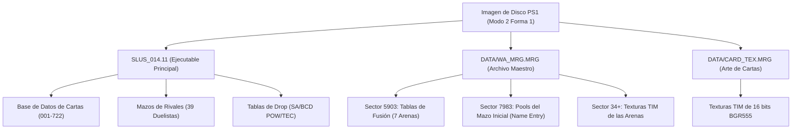

# Especificación Técnica de Arquitectura e Ingeniería Inversa 🛠️📐

Este documento detalla en profundidad el diseño técnico, mapas de memoria, estructura de sectores del CD-ROM de PlayStation 1 y modelos matemáticos implementados en la **Yu-Gi-Oh! Forbidden Memories ROM Suite**.

---

## 1. Formato del CD-ROM de PlayStation 1: Modo 2 Forma 1

Yu-Gi-Oh! Forbidden Memories utiliza sectores **CD-ROM XA Modo 2 Forma 1** para todos sus archivos de datos y ficheros de audio/vídeo comprimidos. Cada sector físico en el disco mide exactamente **2,352 bytes**, organizados de la siguiente forma:

```
+-----------------------------------------------------------------------------------------------+
|  Sync   | Header | Sub-header |      Carga Útil (User Data)          |  EDC   | Zero Pad | P/Q Parity |
| 12 B    |  4 B   |    8 B     |          2,048 B                     |  4 B   |   8 B    |   276 B    |
+-----------------------------------------------------------------------------------------------+
0         12       16           24                                     2072     2076       2084         2352
```

### Desglose del Sector
1. **Patrón de Sincronización (12 bytes):** `00 FF FF FF FF FF FF FF FF FF FF 00`
2. **Cabecera Principal (Header - 4 bytes):**
   - Minuto (BCD, byte 12)
   - Segundo (BCD, byte 13)
   - Sector / Frame (BCD, byte 14)
   - Modo (byte 15, `0x02` para Modo 2)
3. **Subcabecera (Sub-header - 8 bytes):** Número de archivo, Canal, Submodo e Información de Codificación (duplicados para tolerancia a fallos). En sectores de datos estándar, el Submodo es `0x08` (Forma 1, Datos).
4. **Carga Útil de Datos (2,048 bytes):** El contenido accesible a través del sistema de ficheros ISO-9660.
5. **EDC - Código de Detección de Errores (4 bytes, little-endian):**
   - CRC polinomial de 32 bits calculado sobre los bytes 16 a 2071 (Subcabecera + Datos).
   - Generado con el polinomio estándar: $P(x) = (x^{16} + x^{15} + x^2 + 1)(x^{16} + x^2 + x + 1)$.
6. **Relleno Cero (Zero Pad - 8 bytes):** Bytes nulos de alineación (`0x00`).
7. **Paridad L-EC (276 bytes):**
   - **P-Parity (172 bytes):** Paridad entrelazada Reed-Solomon $(26, 24)$ calculada en el Campo de Galois $GF(2^8)$ con polinomio primitivo $P(x) = x^8 + x^4 + x^3 + x^2 + 1$ (`0x11D`).
   - **Q-Parity (104 bytes):** Paridad entrelazada Reed-Solomon $(45, 43)$ calculada en $GF(2^8)$.

> **Nota:** Cuando [`core/builder.py`](../core/builder.py) inyecta sectores modificados, recalcula el checksum EDC y reconstruye las matrices de paridad P y Q al vuelo con [`core/cdrom.py`](../core/cdrom.py). De este modo, ningún emulador o consola real rechaza la imagen por errores de verificación física.

---

## 2. Estructura de Ficheros y Mapa de Sectores del Disco

El disco contiene los siguientes archivos fundamentales para la ejecución:



### Tabla de Offsets y Sectores Físicos

| Archivo / Región | Sector / Offset en Disco | Dirección en RAM | Descripción |
|---|---|---|---|
| `SLUS_014.11` | Sector 23+ | `0x80010000` | Ejecutable PS-X con el motor base, estadísticas de cartas, drops y mazos. |
| `DATA/WA_MRG.MRG` | Sector 5000+ | Carga Dinámica | Archivo compuesto que contiene arenas 3D, overlays de duelo y fusiones. |
| ↳ Tabla Fusiones Arena 0 | Sector 5903 (`0x0B87800`) | `0x8017C2D8` (64 KB) | 722 punteros de cabecera + recetas empaquetadas. |
| ↳ Texturas TIM Arena 0 | Sector 5936 (`0x0B98000`) | VRAM / Texturas | Página de texturas de la Arena 0 (inmediatamente contigua a fusiones). |
| ↳ Overlay Mazo Inicial | Sector 7983 (`0x00F97800`) | `0x8016a930` | Lógica de pantalla de nombre y 7 pools de extracción del mazo inicial. |
| `DATA/CARD_TEX.MRG` | Variable | VRAM / Texturas | 722 texturas TIM individuales en 16 bits BGR555 para las ilustraciones. |

---

## 3. Serialización de Cartas y Motor de Descripciones

### 3.1 Estructura Binaria de la Carta (`core/cards.py`)
Cada una de las 722 cartas de `SLUS_014.11` se representa mediante un registro binario que contiene:
- **ID de Carta:** Entero de 16 bits (1 a 722).
- **Ataque (ATK):** Entero sin signo de 16 bits (0 a 9999).
- **Defensa (DEF):** Entero sin signo de 16 bits (0 a 9999).
- **Estrellas Guardias:** Campo empaquetado de 8 bits para la Estrella 1 y Estrella 2 según las ruedas celestiales de bonificación:
  $$\text{Rueda 1: } \text{Sol} \rightarrow \text{Luna} \rightarrow \text{Venus} \rightarrow \text{Mercurio} \rightarrow \text{Sol}$$
  $$\text{Rueda 2: } \text{Marte} \rightarrow \text{Júpiter} \rightarrow \text{Saturno} \rightarrow \text{Urano} \rightarrow \text{Plutón} \rightarrow \text{Neptuno} \rightarrow \text{Marte}$$
- **Tipo de Carta:** 8 bits (0 a 23, que comprende 20 tipos de monstruos + Magia, Trampa y Ritual).
- **Coste en Estrellas (Star Chips):** Entero de 32 bits (0 a 999,999).
- **Contraseña BCD:** 4 bytes en formato Decimal Codificado en Binario (BCD) que representan el código de 8 dígitos de la carta física.

### 3.2 Glifos Gráficos en Descripciones (`[Bestia]`, `[Guerrero]`, etc.)
En tiempo de ejecución, la PS1 renderiza íconos de tipo dentro de las cajas de texto utilizando una secuencia de escape de 3 bytes:
```text
Byte 0: 0xF8  (Prefijo de escape)
Byte 1: 0x0B  (Comando de dibujado de glifo)
Byte 2: <type_id> (Identificador numérico de tipo)
```

La suite detecta e inserta estas secuencias automáticamente a partir de etiquetas legibles en español e inglés:
```python
GLYPH_ESCAPE = b'\xF8\x0B'
TYPE_GLYPHS = {
    0: "Dragon",       1: "Spellcaster",  2: "Zombie",      3: "Warrior",
    4: "Beast-Warrior",5: "Beast",        6: "Winged Beast",7: "Fiend",
    8: "Fairy",        9: "Insect",      10: "Dinosaur",   11: "Reptile",
    12: "Fish",       13: "Sea Serpent", 14: "Machine",    15: "Thunder",
    16: "Aqua",       17: "Pyro",        18: "Rock",       19: "Plant",
    20: "Magic",      21: "Trap",        22: "Ritual"
}
```
Al guardar, [`core/cards.py`](../core/cards.py) traduce tanto `[Beast]` como `[Bestia]`, `[Warrior]` como `[Guerrero]`, `[Mago]`, `[Lanzador de Conjuros]`, etc., directamente a `0xF8 0x0B <type_id>`.

---

## 4. Motor de Fusiones y Tablas de las 7 Arenas

### 4.1 Simetría en Ensamblador MIPS R3000
En el código de la PS1 en RAM `0x80019a60` (`SLUS_014.11`), la rutina de comprobación de fusiones ordena los registros de entrada por tamaño antes de buscar en la tabla:

```mips
# $a0 = Carta 1, $a1 = Carta 2
slt   $v0, $a1, $a0        # ¿Es Carta 2 < Carta 1?
beq   $v0, $zero, no_swap  # Si no, mantener orden
nop
addu  $v0, $a1, $zero      # Intercambiar registros:
addu  $a1, $a0, $zero      # $a0 = min(Carta 1, Carta 2)
addu  $a0, $v0, $zero      # $a1 = max(Carta 1, Carta 2)
no_swap:
```

Dado que la CPU siempre busca partiendo de la carta de menor índice ($c_{\text{min}} = \min(c_1, c_2)$), [`core/fusions.py`](../core/fusions.py) garantiza que todas las recetas se almacenen bajo `host = min(c1, c2)`. Esto asegura bidireccionalidad total en el juego sin duplicar memoria ni generar inconsistencias.

### 4.2 Límite Estricto de 64 KB de Memoria
- **Reserva en RAM:** En `SLUS_014.11` offset `0x7af4` (`0x800172f4`), la instrucción `lui $v1, 0x1` reserva exactamente **65,536 bytes (64 KB)** en la dirección `0x8017C2D8`.
- **Límites en Disco:** La tabla de fusiones de la Arena 0 comienza en `DATA/WA_MRG.MRG` sector 5903 (`0x0B87800`) y abarca 33 sectores ($33 \times 2048 = 67,584$ bytes). En el sector 34 (`0x0B98000`) inician las texturas TIM de la arena.
- **Protección Activa:** La suite limita la tabla a $\le 65,536$ bytes. Herramientas antiguas que grababan 70,000 bytes sobrescribían el sector 34, destruyendo las texturas del juego y congelando la pantalla al entrar en combate.

---

## 5. Sistema Auténtico de 7 Pools del Mazo Inicial

### 5.1 Overlay de la Pantalla de Nombre (`DATA/WA_MRG.MRG` Sector 7983)
Al iniciar una Nueva Partida, el juego no lee el ejecutable `SLUS_014.11`. En su lugar, carga el overlay de `WA_MRG.MRG` en el sector 7983 (offset `0x00F97800`).
En el offset interno `0x263d4` (`WA` offset `0x00FBDBD4`), se localizan los **7 pools de generación**. Cada pool contiene:
- `uint16 draws`: Número de cartas que se extraen de este pool.
- `uint16 weights[722]`: Pesos de probabilidad de cada carta del juego.

La distancia de separación entre cada pool es de **1,464 bytes** (`0x5B8`):

```
Pool 0 (Monstruos Menores):    Offset 0x00FBDBD4 | Extracciones: 16 | Suma de Pesos: 2048
Pool 1 (Monstruos Medios):     Offset 0x00FBE18C | Extracciones: 16 | Suma de Pesos: 2048
Pool 2 (Monstruos Fuertes):    Offset 0x00FBE744 | Extracciones:  4 | Suma de Pesos: 2048
Pool 3 (Monstruos Clave):      Offset 0x00FBECFC | Extracciones:  1 | Suma de Pesos: 2048
Pool 4 (Magias de Limpieza):   Offset 0x00FBF2B4 | Extracciones:  1 | Suma de Pesos: 2048 (Vanilla: Raigeki / Dark Hole)
Pool 5 (Magias de Campo):      Offset 0x00FBF86C | Extracciones:  1 | Suma de Pesos: 2048 (Vanilla: 6 Campos)
Pool 6 (Magias de Equipo):     Offset 0x00FBFE24 | Extracciones:  1 | Suma de Pesos: 2048
----------------------------------------------------------------------------------------
Total de Cartas Generadas:                       Extracciones: 40 cartas
```

### 5.2 Modelo Matemático de Probabilidad
Para una carta con peso $w_p \in [0, 2048]$ en el pool $p$, la probabilidad de ser elegida en un solo sorteo es:
$$P(\text{extracción} \mid p) = \frac{w_p}{2048}$$

A lo largo de los 7 sorteos independientes, la probabilidad exacta de que el jugador obtenga **al menos 1 copia** en su baraja de 40 cartas es:
$$P(\ge 1 \text{ copia}) = 1.0 - \prod_{p=0}^{6} \left(1.0 - \frac{w_p}{2048}\right)^{\text{draws}_p}$$

El número esperado de copias viene dado por:
$$E[\text{copias}] = \sum_{p=0}^{6} \left(\text{draws}_p \times \frac{w_p}{2048}\right)$$

Al configurar una carta como **100% Garantizada** ($w_p = 2048$), $(1 - 1)^d = 0$, asegurando que $P(\ge 1) = 1.0$ (aparición garantizada en el mazo inicial).

---

## 6. Motor Universal de Recompensas (Drop x1 a x100 y Anti-Bloqueos)

En el juego original, la pantalla de victoria entrega solo 1 carta de recompensa. Al intentar subir el número de cartas con métodos convencionales, ocurrían bloqueos de pantalla negra y cuelgues de sonido.

### Causas del Bloqueo Original:
1. **Bandera de Fadeout de Audio:** El juego espera a que la pista de audio del duelo se silencie por completo antes de continuar con los cuadros de diálogo. Al recibir múltiples cartas con rapidez, el controlador de audio no limpia la bandera y el procesador entra en un bucle infinito.
2. **Desbordamiento del Búfer de Pantalla:** La interfaz visual de la PS1 solo está diseñada para mostrar 1 carta en pantalla.

### Solución Implementada:
[`core/engine_patches.py`](../core/engine_patches.py) inyecta una rutina optimizada en RAM `0x80022000`:
1. **Inyección Directa al Baúl (`0x801db430`):** En lugar de saturar la interfaz gráfica con múltiples cartas, las cartas adicionales generadas por el motor de drops se depositan directamente en el baúl del jugador en memoria.
2. **Limpieza de la Bandera de Audio:** Se desactiva explícitamente la bandera de fadeout de audio antes de cerrar el bucle de victoria.
3. **Retorno Limpio:** Salto directo al epílogo de cuadro (`0x8002209c`), devolviendo el flujo al mapa de campaña sin interrupciones.

---

## 7. Pruebas Automatizadas y Calidad

La suite cuenta con 53 pruebas continuas que validan:
- Generación exacta de paridades EDC/ECC en Modo 2 Forma 1 contra imágenes auténticas.
- Respeto estricto del límite de 64 KB en las 7 arenas de combate.
- Fórmulas de probabilidad y pesos en los 7 pools de mazo inicial.
- Ciclos completos de lectura, edición y recompilación tanto para ISOs Vanilla como Dream Mod.
